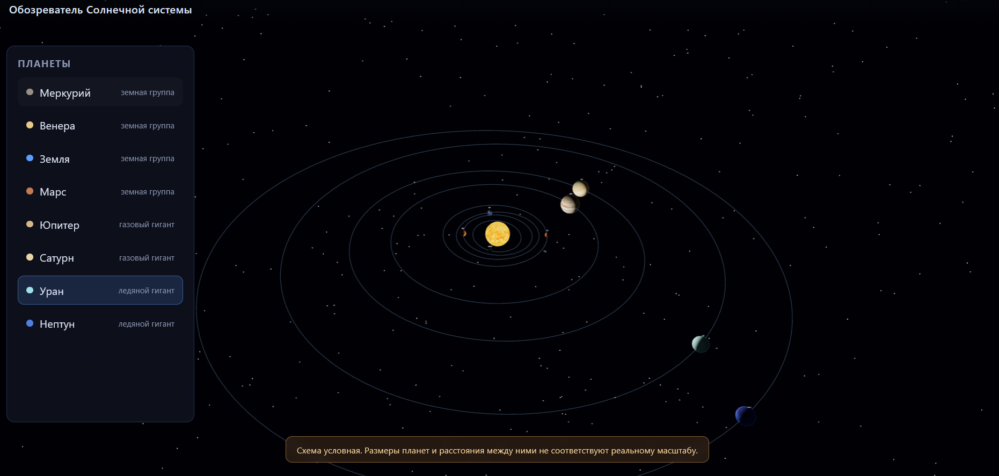
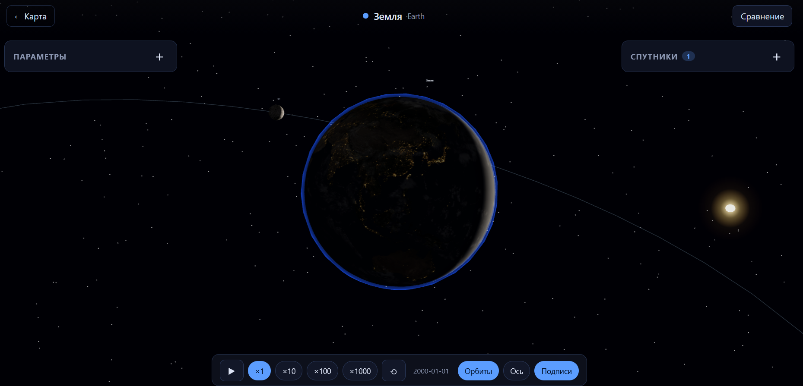
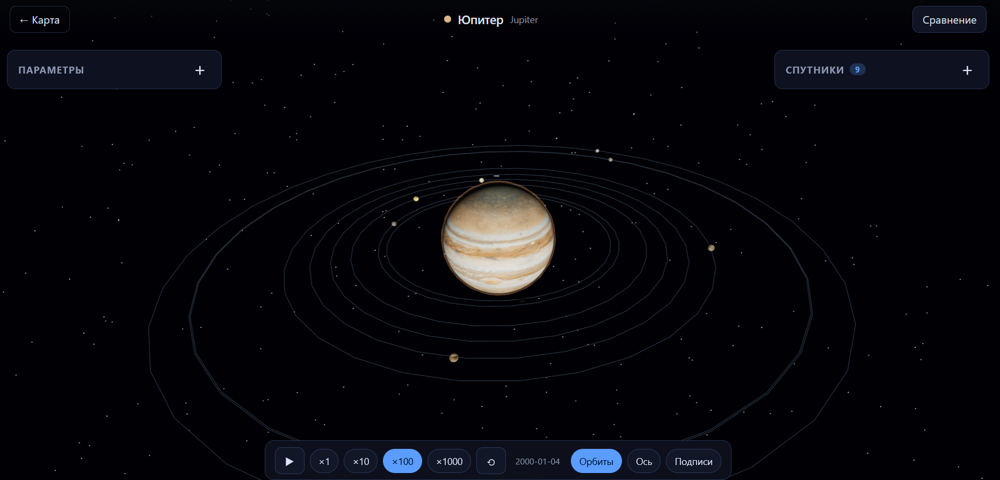

# 🌌 Обозреватель Солнечной системы (Solar System Explorer)

Интерактивное образовательное 3D-приложение для изучения планет и их спутников. Проект написан на чистом JavaScript с использованием библиотеки **Three.js** и работает прямо в браузере без необходимости сборки (No-build step).

## ✨ Возможности

- **3D Карта Солнечной системы**: 8 планет на орбитах с реалистичным эллиптическим движением (модель Кеплера).
- **Детальный просмотр**: Терминатор (день/ночь) формируется за счёт реального освещения, а не текстур. Учтён наклон оси и скорость вращения каждой планеты.
- **20 спутников**: Галилеевы спутники, крупные луны Сатурна, Урана, Тритон, Фобос и Деймос с индивидуальными текстурами.
- **Следование камеры**: При выборе спутника камера плавно подлетает к нему и летит вместе с ним по орбите.
- **Визуальное Солнце**: При взгляде на ночную сторону планеты вдалеке виден источник света (блик).
- **Ночные огни Земли**: Отдельный emissive-слой, который проявляется только на теневой стороне.
- **Адаптивный UI**: Мобильный интерфейс спроектирован отдельно: панели не перекрывают 3D-сцену, кнопки удобны для тапов.
- **Сравнение планет**: Режим сравнения физических характеристик с логарифмическими шкалами.
- **Управление временем**: Пауза, ускорение времени (×1, ×10, ×100, ×1000), сброс.

## 🛠 Технологии

- **HTML5 / CSS3** (Flexbox, CSS Variables, адаптивная верстка, Safe Areas для iOS).
- **JavaScript (ES6+)**.
- **Three.js** (WebGL 2) — загружается через CDN (`importmap`).
- **OrbitControls** — для управления камерой.

## 🚀 Как запустить локально

Из-за политики безопасности браузеров (CORS) приложение **не будет работать**, если просто открыть файл `index.html` двойным кликом (протокол `file://`). Текстуры и ES-модули заблокируются.

Вам нужен любой локальный веб-сервер. Выберите один из вариантов:

**Вариант 1: Через Python (если установлен)**
```bash
python -m http.server 8000
```
Откройте в браузере: `http://localhost:8000`

**Вариант 2: Через Node.js / npx**
```bash
npx serve .
```
Откройте адрес, который появится в консоли (обычно `http://localhost:3000`).

**Вариант 3: Через VS Code**
Установите расширение **Live Server**, нажмите правой кнопкой мыши на `index.html` и выберите **"Open with Live Server"**.

## 📂 Структура проекта

```text
solar-viewer/
├── index.html          # Главный HTML файл (шрифты, importmap)
├── styles.css          # Все стили интерфейса и адаптивность
├── scripts.js          # Вся логика: 3D-сцена, данные, UI, математика
└── textures/           # Папка с текстурами
    ├── 2k_mercury.jpg
    ├── 2k_earth_daymap.jpg
    ├── ...
```

## 📜 Атрибуция и Лицензии

Физические данные (радиусы, массы, орбитальные периоды) взяты из **NASA/JPL Planetary Physical Parameters**.

Текстуры взяты из открытых источников и требуют указания авторства:

- **Solar System Scope** (Планеты, Луна) — [CC BY 4.0](https://www.solarsystemscope.com/textures/)
- **Celestia Motherlode** (Фобос, Деймос, спутники Сатурна) — CC0 (Public Domain)
- **FarGetaNik** (Спутники Урана) — [CC BY-SA 4.0](https://www.deviantart.com/fargetanik)
- **Askaniy** (Тритон) — [CC BY 3.0](https://www.deviantart.com/askaniy)

Код проекта распространяется под лицензией **MIT**.

## 📸 Скриншоты

- Карта Солнечной системы

- Вид на Землю с ночными огнями

- Вид на Юпитер с галилеевыми спутниками

---
*Сделано с любовью к космосу и при помощи AI-агентов*

## Примечание

### *ОСТОРОЖНО: возможны баги и медленная загрузка текстур во время исследования!*

